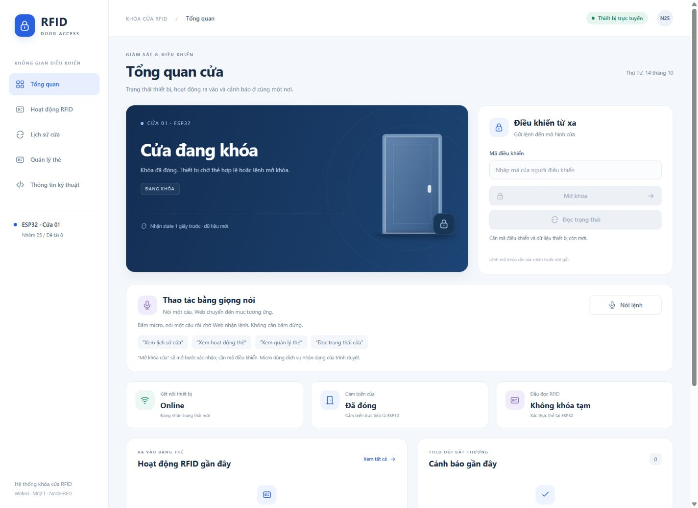

# IoT RFID Door Lock

Mô hình khóa cửa RFID dùng **ESP32, MQTT, Node-RED và Web App**, mô phỏng bằng Wokwi. Project minh họa luồng từ đọc thẻ và điều khiển khóa đến giám sát, cảnh báo và gửi lệnh từ trình duyệt.

[Hướng dẫn chạy](docs/getting-started.md) · [Kiến trúc](docs/architecture.md) · [Kết quả demo](docs/results.md) · [Kiểm thử](docs/testing.md) · [Changelog](CHANGELOG.md)

## Demo



Giao diện Web ngày 14/10/2026: trạng thái cửa, điều khiển và voice ở các khung riêng. Ảnh và kết quả Wokwi tuần 8 được giữ trong Results. Xem [kết quả và phạm vi kiểm thử](docs/results.md).

Tuần 8 đã build firmware, sửa lỗi idle, chạy 10 chu kỳ RFID đầy đủ, hai đợt cho mỗi cảnh báo và quan sát hơn 15 phút với 893/893 mẫu Online. Đã chạy thêm10 chu kỳ Web mở/đóng và RFID local khi ngắt mạng, chốt M4 nội bộ trong mô phỏng. Video báo cáo cuối/người chạy độc lập còn cần bổ sung. [Kết quả và phạm vi xác minh](docs/results.md#tích-hợp-tuần-8-ngày-13102026).

Tuần 9 (14/10/2026): chặn event/ACK khác phiên, đối chiếu ACK bằng seq/session, xử lý body HTTP lỗi và chuẩn hóa hướng dẫn. Bộ test kế thừa cùng 23 W7 + 8 dashboard + 11 W8 + 14 W9 + 6 HTTP đều đạt; đã hồi quy log/API RFID, khóa tạm và R1/R2 với thao tác Wokwi của người dùng. [Kết quả tuần 9](docs/results.md#kiểm-thử-hệ-thống-tuần-9--14102026).

## Chức năng

- **RFID:** quản lý tên và quyền thẻ trên Web; thêm/sửa/tắt/xóa, giới hạn ngày/giờ và ngày hết hạn, lưu trên ESP32; chống đọc lặp và khóa tạm sau nhiều lần bị từ chối.
- **Điều khiển khóa:** relay/servo, chờ mở cửa và khóa lại theo timer.
- **Cảnh báo:** phát hiện cửa mở khi chưa được cấp quyền, nhắc khi mở cửa hợp lệ quá lâu.
- **MQTT:** trao đổi state, event, availability, command và ACK; kiểm tra session/sequence.
- **Web:** dashboard responsive với năm tab Tổng quan/RFID/Lịch sử/Quản lý thẻ/Kỹ thuật; tìm kiếm, lọc nguồn/ngày, xuất CSV; cảnh báo, status/unlock và hộp xác nhận. Dropdown và lịch ngày đồng bộ giao diện; giờ mỗi ngày có đồng hồ chọn hoặc nhập tay.
- **Middleware:** mã điều khiển cho API, kiểm tra online/freshness, chặn sử dụng state retained để cấp quyền, hai rule DOOR_FORCED/LEFT_OPEN_WARN và lịch sử xử lý từng rule.
- **Telegram tùy chọn:** gửi cảnh báo cửa, lịch sử bổ sung và mất/kết nối lại; xem trạng thái/lịch sử bằng nút tiếng Việt hoặc `/status`, `/history`; cấu hình local và chống gửi lặp. [Thiết lập và phạm vi](docs/telegram.md).
- **Giọng nói trên Web:** nói câu tiếng Việt để chuyển tab hoặc đọc trạng thái; mở khóa qua bước xác nhận. Có thanh mức âm và thông báo lỗi micro/dịch vụ. [Hướng dẫn và phạm vi xác minh](docs/voice-proposal.md).
- **Nhật ký Offline:** ESP32 giữ sự kiện trong NVS và gửi bù có xác nhận; tab Lịch sử cửa giữ nhật ký qua restart Web, Telegram gửi bản tổng hợp lịch sử. [Cơ chế và giới hạn](docs/offline-history.md).

## Hoạt động thế nào?

```text
RFID / công tắc cửa -> ESP32 -> relay / servo / buzzer
                         |
                         | MQTT
                         v
                       Broker <-> Node-RED <-> Web App
```

Node-RED chạy trên máy tính và phục vụ Web. Firmware chạy trên ESP32 mô phỏng. Xem [sơ đồ mạch, GPIO, trạng thái cửa và MQTT/API](docs/architecture.md).

## Yêu cầu

- VS Code với **PlatformIO IDE** và **Wokwi for VS Code** đã kích hoạt giấy phép.
- **Node.js 24.x** được khuyến nghị; Node-RED trong lockfile yêu cầu tối thiểu **22.9.0**.
- Internet để kết nối broker MQTT công cộng.
- Git để clone. Python chỉ cần khi dùng console chẩn đoán tùy chọn trong `tools/`.

Luồng chính không cần tạo Python venv hoặc cài Node-RED toàn cục.

## Bắt đầu nhanh

1. Clone repo bằng URL trong nút **Code** trên GitHub; thay placeholder bên dưới bằng URL thật:

   ```sh
   git clone <REPOSITORY_URL> iot-rfid-door-lock
   cd iot-rfid-door-lock
   ```

2. Mở thư mục vừa clone trong VS Code. Dùng **PlatformIO: Build** cho `esp32dev` và chờ SUCCESS. Nếu PlatformIO CLI đã có, có thể dùng `pio run` tại gốc repo.
3. Mở terminal tại gốc repo, cài và chạy middleware:

   ```powershell
   cd middleware
   npm.cmd ci
   npm.cmd run flow
   npm.cmd test
   npm.cmd start
   ```

   Trên macOS/Linux dùng `npm` thay `npm.cmd`. Chỉ cần `npm ci` khi cài lần đầu hoặc cài lại theo lockfile.

4. Chọn **Wokwi: Start Simulator** trong Command Palette.
5. Mở `http://127.0.0.1:1880/door`. Mã điều khiển tự tạo trong `middleware/operator_code.txt`; nhập mã vào Web khi thiết bị có dữ liệu trực tiếp. Editor ở `http://127.0.0.1:1880/editor`.

Giữ công tắc cửa CLOSED khi bắt đầu. Thử thẻ Blue `01020304` hoặc Green `11223344`; quan sát servo và trạng thái trên Web. HTTP gửi thành công chưa xác nhận servo chuyển động: đọc ACK và quan sát mô hình.

Nếu nhiều người chạy bản clone đồng thời, chọn topic BASE riêng và sửa đồng bộ firmware/middleware trước khi build. Xem [cài đặt, cấu hình, chạy demo và xử lý lỗi](docs/getting-started.md).

## Tài liệu

| Trang | Nội dung |
|---|---|
| [Getting started](docs/getting-started.md) | Cài công cụ, cấu hình, build, chạy, Python console và khắc phục lỗi |
| [Architecture](docs/architecture.md) | Source, GPIO, state machine, timer, MQTT và HTTP API |
| [Results](docs/results.md) | Các tình huống đã chạy, ảnh Web, kết quả và giới hạn xác minh |
| [Testing](docs/testing.md) | Test logic, kiểm thử mô phỏng và cách ghi kết quả |
| [Telegram](docs/telegram.md) | Tạo bot, chọn Chat ID, gửi thử và nhận R1/R2 |
| [Offline history](docs/offline-history.md) | Lưu NVS, gửi bù, lịch sử Web/Telegram và kết quả thực |
| [Voice](docs/voice-proposal.md) | Câu nói, tự chuyển tab, kiểm tra micro và giới hạn trình duyệt |
| [Quản lý thẻ](docs/card-management.md) | Thêm/sửa/tắt/xóa thẻ, lịch sử dụng và ngày hết hạn |
| [Changelog](CHANGELOG.md) | Thay đổi đã thực hiện theo ngày |

## Cấu trúc project

```text
src/                 Firmware ESP32
include/             Header và cấu hình mạng
application/         HTML, CSS và JavaScript dashboard
middleware/          Node-RED, generator, logic và test
tools/              Python console tùy chọn
docs/               Hướng dẫn, kết quả và ảnh demo
platformio.ini       Board và dependency firmware
diagram.json         Mạch Wokwi
wokwi.toml           Cấu hình mô phỏng
CHANGELOG.md         Lịch sử thay đổi
```

`.pio/`, `node_modules/`, `.venv/`, `runtime/`, mã điều khiển và flow sinh tại máy được loại bằng `.gitignore`. Repo giữ source generator và `package-lock.json`; không cần các folder báo cáo tuần để chạy.

## Trạng thái và giới hạn

Bản hiện tại phát triển từ baseline tuần 6, bổ sung rule nhắc đóng cửa, lịch sử xử lý và dashboard theo dõi RFID ở tuần 7. Ngày 12/10/2026, **23/23 regression tuần 7, 8/8 bài logic dashboard và bộ middleware kế thừa đạt**. Buổi kiểm thử trước nâng cấp dashboard ghi nhận 7/7 bài P0 theo phạm vi logic/HTTP/Wokwi, hai đợt R1/R2 và offline/reconnect. Phạm vi kiểm tra giao diện mới được ghi riêng tại [Results](docs/results.md).

Project phục vụ học tập/mô phỏng. Broker mặc định là công cộng, chưa có TLS/ACL; whitelist dựa trên UID. Chưa thử khóa cửa thật. Telegram R1/R2 và lịch sử gửi bù đã được người dùng xác nhận nhận tin thực. Nhật ký NVS có giới hạn 24 bản ghi chưa ACK; xem phạm vi trong Offline history. Voice đã triển khai; người dùng đã xác nhận tự chuyển tab và hộp xác nhận mở khóa sau khi bật lại micro.

## Hướng phát triển

- [x] Bổ sung rule nhắc đóng cửa mở hợp lệ quá lâu và regression logic.
- [x] Xác minh Wokwi cho hai rule, reset và hai đợt hoạt động.
- [x] E2E lặp lại, stale khi vẫn online, mất mạng/kết nối lại và khởi động lại; xem phạm vi trong Results.
- [x] Bổ sung ảnh mô hình và kiểm tra cài/build/Web từ bản sạch cùng máy.
- [ ] Video demo và kết quả một người khác chạy bản sạch.

Chỉ đưa tính năng vào mục Chức năng khi đã triển khai; cập nhật kết quả kiểm thử và changelog khi có thay đổi thực tế.

## Đóng góp

Khi sửa code, mô tả thay đổi và cách kiểm tra. Chạy test phù hợp, đồng bộ cấu hình MQTT giữa firmware/middleware và đưa thay đổi flow về generator trước khi tạo lại. Nếu báo lỗi, kèm bước tái hiện, phiên bản công cụ và log đã loại mã điều khiển.

## Thư viện sử dụng

Firmware dùng Arduino cho ESP32, [PubSubClient](https://github.com/knolleary/pubsubclient), [MFRC522](https://github.com/miguelbalboa/rfid), [ESP32Servo](https://github.com/madhephaestus/ESP32Servo) và [ArduinoJson](https://arduinojson.org/). Middleware dùng [Node-RED](https://nodered.org/). Phiên bản dependency nằm trong `platformio.ini` và `middleware/package-lock.json`.

## Giấy phép

Nhóm chưa chốt giấy phép riêng cho project. File LICENSE sẽ được bổ sung khi có quyết định; giấy phép của các dependency thuộc từng thư viện.
