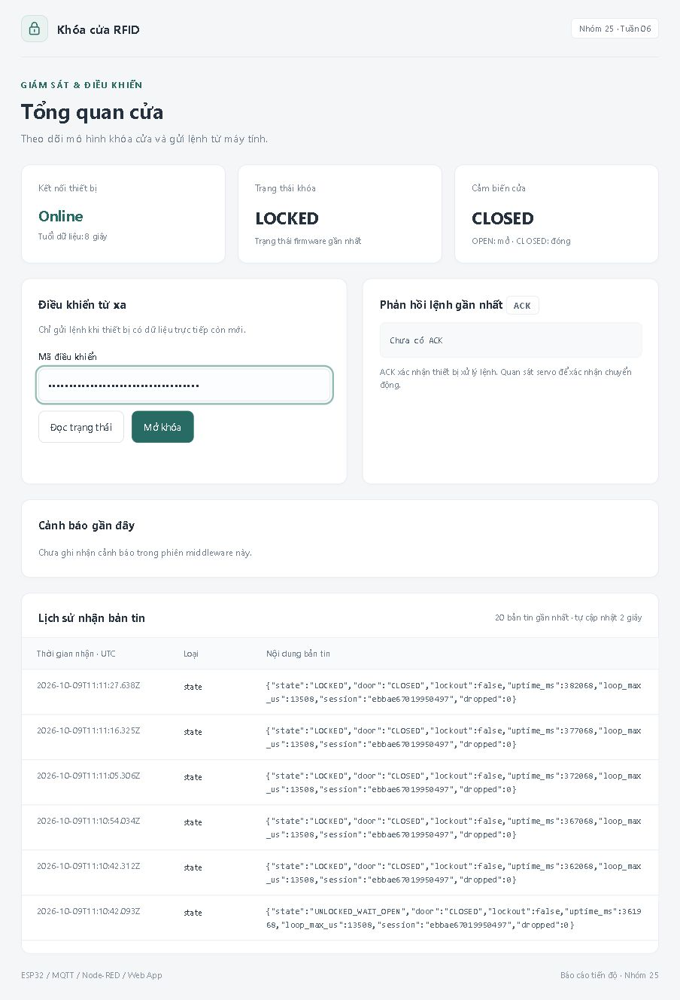

# IoT RFID Door Lock

Mô hình khóa cửa RFID dùng **ESP32, MQTT, Node-RED và Web App**, mô phỏng bằng Wokwi. Project minh họa luồng từ đọc thẻ và điều khiển khóa đến giám sát, cảnh báo và gửi lệnh từ trình duyệt.

[Hướng dẫn chạy](docs/getting-started.md) · [Kiến trúc](docs/architecture.md) · [Kết quả demo](docs/results.md) · [Kiểm thử](docs/testing.md) · [Changelog](CHANGELOG.md)

## Demo



Ảnh từ lượt chạy mô phỏng ngày 09/10/2026. Xem thêm [cảnh báo mở cửa trái phép và kết quả kiểm thử](docs/results.md).

## Chức năng

- **RFID:** whitelist thẻ hợp lệ, chống đọc lặp và khóa tạm sau nhiều lần quét sai.
- **Điều khiển khóa:** relay/servo, chờ mở cửa và khóa lại theo timer.
- **Cảnh báo:** phát hiện cửa mở khi chưa được cấp quyền, nhắc khi mở cửa hợp lệ quá lâu.
- **MQTT:** trao đổi state, event, availability, command và ACK; kiểm tra session/sequence.
- **Web:** dashboard, lịch sử bản tin, cảnh báo, lệnh đọc trạng thái/mở khóa và hộp xác nhận.
- **Middleware:** mã điều khiển cho API, kiểm tra online/freshness, chặn sử dụng state retained để cấp quyền và rule DOOR_FORCED.

## Hoạt động thế nào?

```text
RFID / công tắc cửa -> ESP32 -> relay / servo / buzzer
                         |
                         | MQTT
                         v
                       Broker <-> Node-RED <-> Web App
```

Node-RED chạy trên máy tính và phục vụ Web. Firmware chạy trên ESP32 mô phỏng. Xem [sơ đồ mạch, GPIO, trạng thái cửa và MQTT/API](docs/architecture.md).

## Yêu cầu

- VS Code với **PlatformIO IDE** và **Wokwi for VS Code** đã kích hoạt giấy phép.
- **Node.js 24.x** được khuyến nghị; Node-RED trong lockfile yêu cầu tối thiểu **22.9.0**.
- Internet để kết nối broker MQTT công cộng.
- Git để clone. Python chỉ cần khi dùng console chẩn đoán tùy chọn trong `tools/`.

Luồng chính không cần tạo Python venv hoặc cài Node-RED toàn cục.

## Bắt đầu nhanh

1. Clone repo bằng URL trong nút **Code** trên GitHub; thay placeholder bên dưới bằng URL thật:

   ```sh
   git clone <REPOSITORY_URL> iot-rfid-door-lock
   cd iot-rfid-door-lock
   ```

2. Mở thư mục vừa clone trong VS Code. Dùng **PlatformIO: Build** cho `esp32dev` và chờ SUCCESS. Nếu PlatformIO CLI đã có, có thể dùng `pio run` tại gốc repo.
3. Mở terminal tại gốc repo, cài và chạy middleware:

   ```powershell
   cd middleware
   npm.cmd ci
   npm.cmd run flow
   npm.cmd test
   npm.cmd start
   ```

   Trên macOS/Linux dùng `npm` thay `npm.cmd`. Chỉ cần `npm ci` khi cài lần đầu hoặc cài lại theo lockfile.

4. Chọn **Wokwi: Start Simulator** trong Command Palette.
5. Mở `http://127.0.0.1:1880/door`. Mã điều khiển tự tạo trong `middleware/operator_code.txt`; nhập mã vào Web khi thiết bị có dữ liệu trực tiếp. Editor ở `http://127.0.0.1:1880/editor`.

Giữ công tắc cửa CLOSED khi bắt đầu. Thử thẻ Blue `01020304` hoặc Green `11223344`; quan sát servo và trạng thái trên Web. HTTP gửi thành công chưa xác nhận servo chuyển động: đọc ACK và quan sát mô hình.

Nếu nhiều người chạy bản clone đồng thời, chọn topic BASE riêng và sửa đồng bộ firmware/middleware trước khi build. Xem [cài đặt, cấu hình, chạy demo và xử lý lỗi](docs/getting-started.md).

## Tài liệu

| Trang | Nội dung |
|---|---|
| [Getting started](docs/getting-started.md) | Cài công cụ, cấu hình, build, chạy, Python console và khắc phục lỗi |
| [Architecture](docs/architecture.md) | Source, GPIO, state machine, timer, MQTT và HTTP API |
| [Results](docs/results.md) | Các tình huống đã chạy, ảnh Web, kết quả và giới hạn xác minh |
| [Testing](docs/testing.md) | Test logic, kiểm thử mô phỏng và cách ghi kết quả |
| [Changelog](CHANGELOG.md) | Thay đổi đã thực hiện theo ngày |

## Cấu trúc project

```text
src/                 Firmware ESP32
include/             Header và cấu hình mạng
application/         Web App
middleware/          Node-RED, generator, logic và test
tools/              Python console tùy chọn
docs/               Hướng dẫn, kết quả và ảnh demo
platformio.ini       Board và dependency firmware
diagram.json         Mạch Wokwi
wokwi.toml           Cấu hình mô phỏng
CHANGELOG.md         Lịch sử thay đổi
```

`.pio/`, `node_modules/`, `.venv/`, `runtime/`, mã điều khiển và flow sinh tại máy được loại bằng `.gitignore`. Repo giữ source generator và `package-lock.json`; không cần các folder báo cáo tuần để chạy.

## Trạng thái và giới hạn

Bản hiện tại kế thừa code đã bàn giao đến tuần 6. Hồ sơ mô phỏng ghi nhận **8/8 bài kiểm thử đạt trong phạm vi từng bài**; các giới hạn quan sát được nêu ở [Results](docs/results.md). Test middleware offline không thay cho E2E.

Project phục vụ học tập/mô phỏng. Broker mặc định là công cộng, chưa có TLS/ACL; whitelist dựa trên UID. Chưa thử khóa cửa thật. Telegram, mở khóa bằng giọng nói, rule thứ hai và NVS/gửi bù chưa được triển khai.

## Hướng phát triển

- [ ] Mở rộng rule và kiểm thử cho chức năng mới.
- [ ] Bổ sung lượt E2E lặp lại, kiểm tra stale khi vẫn online và tình huống mạng/khởi động lại.
- [ ] Bổ sung ảnh hoặc video mô hình, video demo và kết quả chạy trên máy khác.

Chỉ đưa tính năng vào mục Chức năng khi đã triển khai; cập nhật kết quả kiểm thử và changelog khi có thay đổi thực tế.

## Đóng góp

Khi sửa code, mô tả thay đổi và cách kiểm tra. Chạy test phù hợp, đồng bộ cấu hình MQTT giữa firmware/middleware và đưa thay đổi flow về generator trước khi tạo lại. Nếu báo lỗi, kèm bước tái hiện, phiên bản công cụ và log đã loại mã điều khiển.

## Thư viện sử dụng

Firmware dùng Arduino cho ESP32, [PubSubClient](https://github.com/knolleary/pubsubclient), [MFRC522](https://github.com/miguelbalboa/rfid), [ESP32Servo](https://github.com/madhephaestus/ESP32Servo) và [ArduinoJson](https://arduinojson.org/). Middleware dùng [Node-RED](https://nodered.org/). Phiên bản dependency nằm trong `platformio.ini` và `middleware/package-lock.json`.

## Giấy phép

Nhóm chưa chốt giấy phép riêng cho project. File LICENSE sẽ được bổ sung khi có quyết định; giấy phép của các dependency thuộc từng thư viện.
