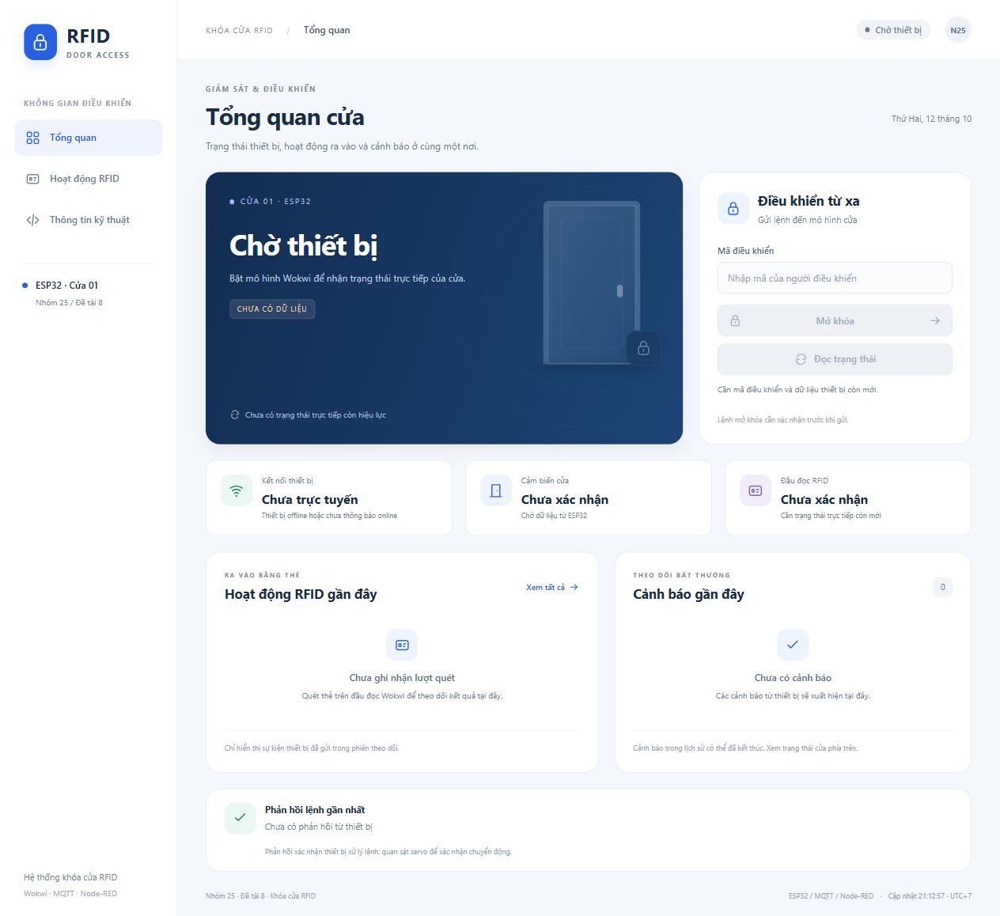
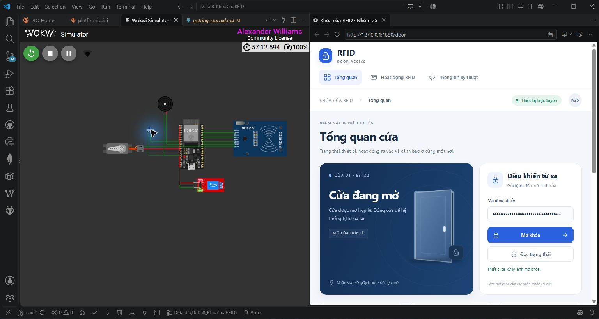

# Kết quả hiện tại

[Về README](../README.md) · [Cách chạy](getting-started.md) · [Kiểm thử](testing.md) · [Lịch sử thay đổi](../CHANGELOG.md)

## Phạm vi

Bản code phát triển từ tuần 6 của nhóm: ESP32 mô phỏng trên Wokwi, MQTT, Node-RED và Web App. Kết quả lịch sử ngày 09/10/2026 và kiểm tra mới ngày 12/10/2026 được ghi riêng dưới đây.

## Sản phẩm đã có

| Thành phần | Nội dung đã triển khai |
|---|---|
| Firmware | RFID whitelist, debounce cửa, các trạng thái khóa, timer, khóa tạm khi quét sai và cảnh báo |
| Mạch mô phỏng | ESP32, RC522, công tắc cửa, relay, servo và buzzer trong diagram.json |
| Kết nối | Wi-Fi/MQTT, state/event/availability/ack, session và sequence cho command |
| Middleware | Model trạng thái, freshness, chặn offline/retained, history, R1 DOOR_FORCED và R2 LEFT_OPEN_WARN |
| Web | Dashboard responsive, ba tab Tổng quan/RFID/Kỹ thuật, trạng thái cửa/khóa, UID và kết quả quét, tìm/lọc RFID, mã điều khiển, status/unlock, xác nhận, ACK và cảnh báo |
| Công cụ | Generator flow, test logic và Python console chẩn đoán tùy chọn |

## Kiểm thử mô phỏng ngày 09/10/2026

Hồ sơ nhóm ghi nhận **8/8 bài đạt trong phạm vi từng bài**, xác nhận luồng thiết bị → MQTT → middleware → Web và chiều điều khiển ngược lại trong mô phỏng. Kết quả thuộc lượt chạy ngày 09/10/2026, không phải cam kết mọi cấu hình hoặc phiên bản sau đều đã được kiểm tra.

| Bài | Kết quả đã ghi nhận |
|---|---|
| W6-01 — Dashboard online | Web nhận state trực tiếp, hiển thị LOCKED/CLOSED |
| W6-02 — Chu kỳ RFID | Blue được cấp quyền; mở/đóng cửa hợp lệ và khóa lại sau khoảng 5 giây mô phỏng |
| W6-03 — Đọc trạng thái | Lệnh status từ Web có ACK executed khớp sequence |
| W6-04 — Mở khóa từ Web | Unlock được thực thi; người dùng xác nhận servo quay mở rồi tự quay về khóa khi giữ cửa CLOSED |
| W6-05 — Mã sai | HTTP 403, không có command MQTT mới |
| W6-06 — Mất mạng | Nhánh netoff khóa nút; API với mã đúng trả 409; state retained không cấp quyền điều khiển |
| W6-07 — Kết nối lại | neton tạo session/state trực tiếp mới; status và ACK hoạt động lại |
| W6-08 — Mở trái phép | DOOR_FORCED tạo cảnh báo; rule gửi status, có ACK; đóng cửa rồi phục hồi LOCKED/CLOSED |

Servo ở W6-04 được người dùng quan sát và xác nhận bằng văn bản; chưa có ảnh/video servo trong hồ sơ đã đối chiếu. W6-06 xác nhận nhánh netoff, chưa đo riêng tình huống state stale khi thiết bị vẫn online trong bài E2E. Có log ALARM_MUTED, nhưng không dùng log đó để khẳng định người dùng đã nghe âm còi.

## Ảnh Web đã có

Hai ảnh dưới được giữ nguyên từ lượt chạy tuần 6 ngày 09/10/2026; mã điều khiển trên ảnh đã được che bằng ô password. Ảnh Web không thay cho ảnh chuyển động servo.

### Dashboard khi online

### Cảnh báo mở cửa trái phép

## Kiểm tra phần mềm sau khi gom project

Ngày 10–11/10/2026 đã đối chiếu source chính với baseline tuần 6, chạy test logic middleware, kiểm tra Node-RED khởi động ở đường dẫn mới và kiểm tra bản sao source độc lập tạo được flow/test. Log mặc định nằm trong runtime của repo; tùy chọn theo tuần vẫn có thể dùng trên máy nhóm.

Các lần kiểm tra này không build lại firmware hay chạy Wokwi E2E mới. Firmware, core và giao diện chức năng vẫn kế thừa tuần 6.

## Kiểm tra phiên bản tuần 7 ngày 12/10/2026

Đã bổ sung R2 nhắc đóng cửa, cờ chống lặp/reset độc lập với R1, log xử lý rule và giao diện phân biệt báo động với lời nhắc. R1 ghi rõ status đã gửi hoặc bị chặn. Firmware và các ngưỡng kế thừa giữ nguyên.

| Kiểm tra | Kết quả và phạm vi |
|---|---|
| Regression tuần 7 | 23/23 đạt, fixture offline |
| Bộ middleware kế thừa | Đạt, gồm function flow và HTTP giả lập |
| HTTP trên Node-RED đang chạy | Mã sai 403, mã đúng khi chưa có thiết bị trực tiếp 409, không command mới |
| Khởi động với retained cũ | API state=null, ready=false, không cảnh báo hoặc rule mới |
| Web thực tế | Trang tải được, nút khóa khi chưa có state trực tiếp, có mục lịch sử xử lý cảnh báo |
| Wokwi baseline | Blue được cấp quyền, mở/đóng hợp lệ và khóa lại; Web status/unlock có ACK khớp seq; người dùng xác nhận servo mở rồi về |
| Wokwi R1 | Hai đợt mở trái phép có cảnh báo/status/ACK; đóng ổn định đến ALARM_CLEARED rồi kích hoạt lại. Người dùng xác nhận nghe còi |
| Wokwi R2 | Hai đợt mở hợp lệ lâu có lời nhắc vàng, giữ DOOR_OPEN_AUTH; một cảnh báo mỗi đợt, reset sau đóng, không command do R2 |
| Ngưỡng R2 | Chênh lệch uptime DOOR_OPENED/LEFT_OPEN_WARN là 14999 và 15000 ms, xấp xỉ 15 giây mô phỏng |
| Wokwi netoff/neton | Serial RFC2217 xác nhận Paused, availability offline; mã đúng 409 và không cmd mới. Phục hồi có session mới, status HTTP 202/ACK executed |

**7/7 bài P0 tuần 7 đạt theo phạm vi đã thiết kế**, gồm baseline, R1, reset R1, R2, reset R2, logic/startup retained và logic/Web/mạng. Đây không phải 7 bài đều chỉ chạy E2E, cũng không cộng 23 fixture thành số lượt Wokwi. P1 stale-online có kiểm soát và hồi quy lockout/remote chưa hoàn tất.

Ảnh mới: [Web R1 ngày 12/10/2026](images/alarm-w7.png), [Web R2 ngày 12/10/2026](images/reminder-w7.jpg). Cảnh báo cũ và ACK cũ còn trong lịch sử dù cửa đã phục hồi.

Chưa build firmware mới: sử dụng binary tuần 6 có sẵn vì không đổi source firmware. Không tính bộ fixture là kết quả Wokwi, chuyển động servo hoặc âm còi.

Lượt R2 đầu mở sau cấp quyền 7558 ms, vượt cửa sổ 5000 ms nên đúng hành vi ALARM; đã thử lại đúng thao tác. Ngưỡng firmware vẫn 15000 ms, timestamp event lấy riêng với thời điểm FSM nên số đo 14999 ms không chứng minh cảnh báo trước ngưỡng nội bộ 1 ms. Serial lần đầu nhận dòng không hợp lệ; lần đó 409 do stale không được tính là offline. Lượt RFC2217 sau xác nhận offline và phục hồi thực.

## Nâng cấp dashboard/RFID ngày 12/10/2026

Sau buổi kiểm thử automation, giao diện được thiết kế lại với màu xanh đậm, minh họa cửa và trạng thái tiếng Việt. Ba tab tách thao tác thường dùng, hoạt động RFID và log kỹ thuật. Firmware không đổi; dữ liệu UID/kết quả lấy từ event đã có.

| Kiểm tra mới | Kết quả và phạm vi |
|---|---|
| Logic dashboard | 8/8 đạt: parsing nguồn/UID, retained, các kết quả RFID, bounded history/counters, kết nối và flow/API |
| Regression | 23/23 bài tuần 7 và bộ middleware kế thừa vẫn đạt |
| Tương tác trình duyệt | 13 mục đạt trên server fixture localhost riêng: lọc, tìm UID, empty state, mã sai, xác nhận/hủy, chờ ACK khớp seq, bàn phím, stale, lockout và ALARM/OPEN |
| Bố cục | Đã xem desktop và mobile 390×844; không tràn ngang trang, ba tab hoạt động, không lỗi console |
| Định dạng event thực tế | Phát lại log MQTT đã ghi trong bộ nhớ; UID 01020304/name blue và số lượt RFID được parse đúng. Đây không phải lượt quét mới |
| Web/Node-RED thực | API mới và HTML/CSS/JS tải được; khi chưa có thiết bị, lịch sử trống và nút bị chặn. HTTP thật: mã sai 403, mã đúng lúc chưa sẵn sàng 409, số command trước/sau đều 0 |
| Quét Blue/Red trực tiếp trên bản mới | Chưa xác minh; lúc chụp ảnh middleware chưa nhận state từ Wokwi |

Ảnh này ghi nhận giao diện và empty state, không chứng minh RFID E2E. Kết quả P0 ở mục trước thuộc buổi kiểm thử automation trước nâng cấp, không tự chuyển thành kết quả kiểm thử lại mọi chức năng của UI mới. Thống kê trên Web tính từ khi middleware khởi động, giữ 100 sự kiện RFID và xóa bộ nhớ khi restart. Khóa tạm hiện tại chỉ hiển thị là đã xác nhận khi state còn mới.

## Tích hợp tuần 8 ngày 13/10/2026

Đã build firmware mới và kiểm tra trên Wokwi/Node-RED thực. Sửa lỗi để mô phỏng chạy im nhưng dashboard thành offline: heartbeat 1 giây mô phỏng, nghỉ loop 5ms, Wi-Fi channel 6; state trực tiếp hợp lệ phục hồi cờ online. Freshness vẫn 12 giây PC và retained không cấp quyền. Event/ACK có session do MQTT worker gắn.

| Kiểm tra | Kết quả |
|---|---|
| Build | SUCCESS, RAM14%, Flash59,7% |
| Logic | Bộ kế thừa đạt, 23/23 W7, 8/8 dashboard, 11/11 tích hợp W8; là fixture |
| Chu kỳ RFID thực | 10/10 Blue → OPEN hợp lệ → CLOSED → tự khóa; 9 vòng có ảnh servo OPEN |
| Web thực | 10/10 chu kỳ click/xác nhận, command/ACK đúng phiên/seq, servo và OPEN/CLOSED/tự khóa |
| R1/R2 | Mỗi rule hai đợt riêng, đóng và kích hoạt lại; R2 sau15.001ms mô phỏng, không tự unlock |
| Stale-online | stateoff khi MQTT còn online → API409; stateon → state mới/statusACK |
| Mất mạng | netoff409, Blue local mở/đóng/tự khóa; neton phiên mới/Web status và unlock ACK |
| Restart | Node-RED retained không cấp quyền; ESP32 phiên mới/LOCKED; command phiên cũ rejected |
| Liên tục | 900,69 giây PC, 893/893 mẫu ready, 0 lỗi HTTP và 0 mẫu offline trong khoảng đo |

M4 đạt nội bộ trong phạm vi mô phỏng, P0 kỹ thuật hoàn tất. Có20 chu kỳ đủ và thêm một chu kỳ Web sau reconnect. Generator và test chạy từ source mới không secrets/node_modules/flow cũ, chưa coi là một người khác chạy E2E. ACK không tự chứng minh actuator; ảnh servo có ở các vòng RFID. Chưa có video liền mạch và người khác chạy độc lập. Lỗi serialize JSON trong lượt phát triển đầu đã sửa bằng input const trước build cuối; lượt sai thao tác mở trễ không tính vào chu kỳ hợp lệ.

## Phần chưa triển khai hoặc chưa có kết quả

Telegram, mở khóa bằng giọng nói, NVS/gửi bù và cấu hình broker TLS/ACL chưa được triển khai. Chưa thử khóa cửa thật. Lockout/remote đã được hồi quy bằng log/API trực tiếp ngày 14/10/2026 như mục tuần 9 bên dưới. Chưa có video/ghi âm.

## Kiểm thử hệ thống tuần 9 — 14/10/2026

Sửa các nhánh event/ACK khác phiên làm nhiễm thống kê RFID, cảnh báo hoặc xác nhận lệnh. Session của event được đối chiếu với state trực tiếp; giữ raw row bị bỏ qua để truy vết. Web yêu cầu ACK khớp seq/session và hủy pending khi thiết bị đổi phiên. Sửa POST JSON lỗi từng trả 500 thành lỗi client 400/413/415. Launcher in đúng host/port cấu hình.

| Kiểm tra | Kết quả thực và giới hạn |
|---|---|
| Logic | Bộ kế thừa và 23 W7 + 8 dashboard + 11 W8 + 14 W9 + 6 HTTP đều đạt; fixture không thay Wokwi |
| HTTP thật | Sai mã 403; action/offline/stale 409; JSON/array 400; quá lớn 413; Content-Type sai 415; status/unlock 202 và ACK đúng session/seq |
| MQTT thật | Firmware từ chối phiên sai, sequence lặp, action sai, JSON và schema sai; không publish state/event giả |
| RFID/R2 | Người dùng quét Blue; mở sau 4640 ms, nhắc sau 15001 ms từ DOOR_OPENED; đóng→khóa 5005 ms |
| Lockout | Red ba lần bị từ chối; Blue bị bỏ qua trong khóa tạm. REMOTE hợp lệ vẫn được cấp quyền/ACK; khóa tạm chỉ áp dụng RFID |
| R1 | Hai DOOR_FORCED và hai R1 trong log lượt quan sát, R1 gửi status; đợt cuối đóng→ALARM_CLEARED |
| Mạng | Stale trong khi MQTT online bị 409; netoff bị 409; Serial unlock local tự khóa khi offline; neton phiên mới có ACK |
| Số đo offline | loop_max_us 2606 µs sau resetstat; chỉ phần xử lý, không gồm nghỉ loop, không đại diện mọi tình huống |
| Bản sạch | Cài 277 package theo lockfile, test, build ESP32 SUCCESS và Web/API cùng máy; BASE/port riêng, chưa thử Wokwi ở bản sạch |

Firmware và timer giữ nguyên so với bản tuần 8; kế thừa minh chứng actuator của bản đó, không ghi lượt tuần 9 là đã chụp/đo servo hoặc âm còi. Chênh timestamp LOCKOUT_START→END là 9997 ms, còn timer source là 10000 ms: mốc bắt đầu timer lấy trước các lần log, mỗi event lấy millis riêng nên chênh event không đo trực tiếp ranh giới timer. Bộ đếm dropped=2 được giữ trong evidence; hệ thống chưa lưu/gửi bù sự kiện offline.

Đã hoàn thiện tài liệu kỹ thuật/source/flow bản ứng viên tuần 9. Video demo draft và người khác chạy bản sạch chưa có minh chứng. Word/PPTX và nghiệm thu tuần 10 chờ yêu cầu của người dùng; chưa phát hành release/tag.

## Bổ sung kiểm tra bản sạch trên máy hiện tại (14/10/2026)

Đã cài từ ZIP source không caches/token, npm ci 277 package, build sạch SUCCESS 19.06 s và chạy binary đó trên Wokwi (source/diagram đối chiếu giống main). Web của bản sạch chạy cùng máy trên 1880 khi Web main đã dừng, một controller. Blue cấp quyền, Yellow55667788 bị từ chối/ba lần sai gây lockout; R1 và R2 hiện thật, có ảnh servo OPEN. Status/unlock bấm trên Edge có ACK đúng session/seq; ba tab, tìm/lọc RFID, mã sai, hủy mở khóa và mobile 390×844 được kiểm tra. HTTP/mạng/stale/offline/reconnect/Stop-Start/restart-retained đúng; không phát telemetry giả. 1151 state trực tiếp trong 1149.359s trước cố ý ngắt mạng, gap lớn nhất 1248 ms; đây là thống kê raw heartbeat, không phải số mẫu API Online.

Sửa thêm nhãn select RFID tách khỏi option text và launcher preflight cổng/mã trống; các 62 fixture cùng bộ kế thừa đều đạt sau sửa. Khôi phục main firmware đúng baseline/hash, giữ Web chính chạy nền và dọn bản tạm. Chạy sạch cùng máy đã hoàn tất theo yêu cầu; người khác chạy là kiểm chứng bổ sung. Video chưa có. Không bổ sung10+10 chu kỳ hoặc Blue ignored mới trong lượt sạch; phạm vi lịch sử ở các mục trước giữ nguyên.

## Telegram R1/R2 (14/10/2026)

Bổ sung sau snapshot G9-RC2. 13 fixture Telegram đạt cùng toàn bộ test kế thừa. Người dùng thực hiện một đợt R1 và một đợt R2 trên Wokwi: rule đúng session, mỗi rule có một hàng Telegram API nhận thành công và người dùng xác nhận thấy cả hai tin. R2 sau 15003 ms mô phỏng; đóng cửa khóa lại sau 5004 ms. Không thay firmware, không thêm điều khiển cửa qua chat. [Thiết lập và phạm vi xác minh](telegram.md).
