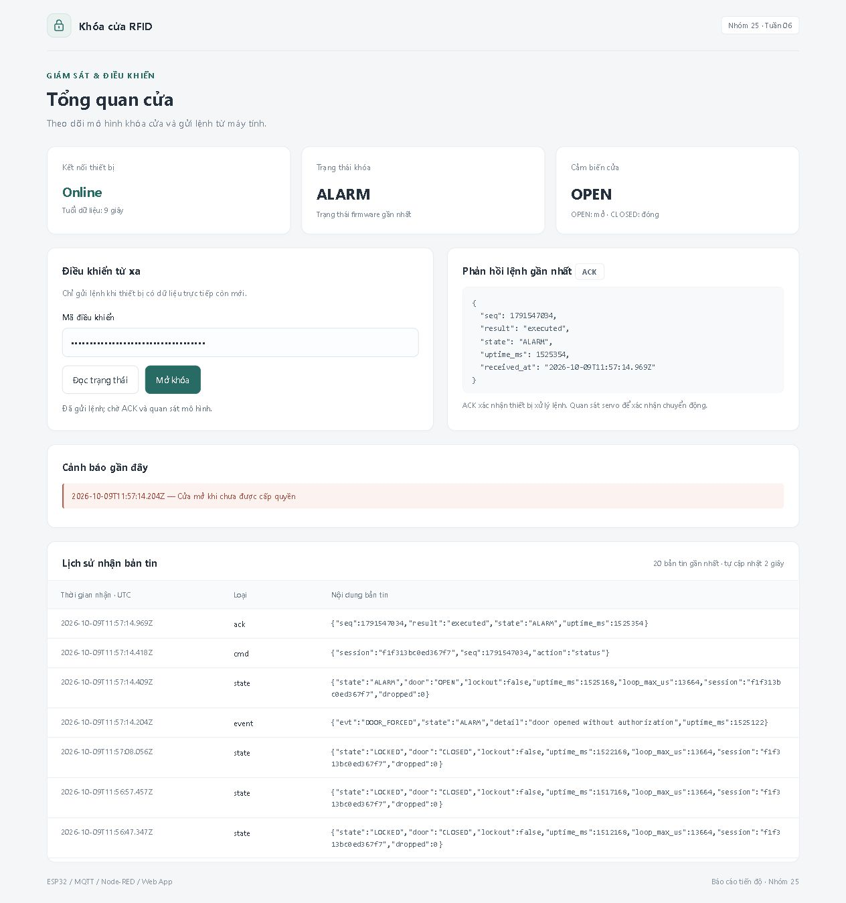

# Kết quả hiện tại

[Về README](../README.md) · [Cách chạy](getting-started.md) · [Kiểm thử](testing.md) · [Lịch sử thay đổi](../CHANGELOG.md)

## Phạm vi

Bản code phát triển từ tuần 6 của nhóm: ESP32 mô phỏng trên Wokwi, MQTT, Node-RED và Web App. Kết quả lịch sử ngày 09/10/2026 và kiểm tra mới ngày 12/10/2026 được ghi riêng dưới đây.

## Sản phẩm đã có

| Thành phần | Nội dung đã triển khai |
|---|---|
| Firmware | RFID whitelist, debounce cửa, các trạng thái khóa, timer, khóa tạm khi quét sai và cảnh báo |
| Mạch mô phỏng | ESP32, RC522, công tắc cửa, relay, servo và buzzer trong diagram.json |
| Kết nối | Wi-Fi/MQTT, state/event/availability/ack, session và sequence cho command |
| Middleware | Model trạng thái, freshness, chặn offline/retained, history, R1 DOOR_FORCED và R2 LEFT_OPEN_WARN |
| Web | Dashboard, trạng thái cửa/khóa, mã điều khiển, status/unlock, hộp xác nhận, ACK, cảnh báo đỏ/vàng và lịch sử xử lý rule |
| Công cụ | Generator flow, test logic và Python console chẩn đoán tùy chọn |

## Kiểm thử mô phỏng ngày 09/10/2026

Hồ sơ nhóm ghi nhận **8/8 bài đạt trong phạm vi từng bài**, xác nhận luồng thiết bị → MQTT → middleware → Web và chiều điều khiển ngược lại trong mô phỏng. Kết quả thuộc lượt chạy ngày 09/10/2026, không phải cam kết mọi cấu hình hoặc phiên bản sau đều đã được kiểm tra.

| Bài | Kết quả đã ghi nhận |
|---|---|
| W6-01 — Dashboard online | Web nhận state trực tiếp, hiển thị LOCKED/CLOSED |
| W6-02 — Chu kỳ RFID | Blue được cấp quyền; mở/đóng cửa hợp lệ và khóa lại sau khoảng 5 giây mô phỏng |
| W6-03 — Đọc trạng thái | Lệnh status từ Web có ACK executed khớp sequence |
| W6-04 — Mở khóa từ Web | Unlock được thực thi; người dùng xác nhận servo quay mở rồi tự quay về khóa khi giữ cửa CLOSED |
| W6-05 — Mã sai | HTTP 403, không có command MQTT mới |
| W6-06 — Mất mạng | Nhánh netoff khóa nút; API với mã đúng trả 409; state retained không cấp quyền điều khiển |
| W6-07 — Kết nối lại | neton tạo session/state trực tiếp mới; status và ACK hoạt động lại |
| W6-08 — Mở trái phép | DOOR_FORCED tạo cảnh báo; rule gửi status, có ACK; đóng cửa rồi phục hồi LOCKED/CLOSED |

Servo ở W6-04 được người dùng quan sát và xác nhận bằng văn bản; chưa có ảnh/video servo trong hồ sơ đã đối chiếu. W6-06 xác nhận nhánh netoff, chưa đo riêng tình huống state stale khi thiết bị vẫn online trong bài E2E. Có log ALARM_MUTED, nhưng không dùng log đó để khẳng định người dùng đã nghe âm còi.

## Ảnh Web đã có

Hai ảnh dưới được giữ nguyên từ lượt chạy tuần 6 ngày 09/10/2026; mã điều khiển trên ảnh đã được che bằng ô password. Ảnh Web không thay cho ảnh chuyển động servo.

### Dashboard khi online

### Cảnh báo mở cửa trái phép

## Kiểm tra phần mềm sau khi gom project

Ngày 10–11/10/2026 đã đối chiếu source chính với baseline tuần 6, chạy test logic middleware, kiểm tra Node-RED khởi động ở đường dẫn mới và kiểm tra bản sao source độc lập tạo được flow/test. Log mặc định nằm trong runtime của repo; tùy chọn theo tuần vẫn có thể dùng trên máy nhóm.

Các lần kiểm tra này không build lại firmware hay chạy Wokwi E2E mới. Firmware, core và giao diện chức năng vẫn kế thừa tuần 6.

## Kiểm tra phiên bản tuần 7 ngày 12/10/2026

Đã bổ sung R2 nhắc đóng cửa, cờ chống lặp/reset độc lập với R1, log xử lý rule và giao diện phân biệt báo động với lời nhắc. R1 ghi rõ status đã gửi hoặc bị chặn. Firmware và các ngưỡng kế thừa giữ nguyên.

| Kiểm tra | Kết quả và phạm vi |
|---|---|
| Regression tuần 7 | 23/23 đạt, fixture offline |
| Bộ middleware kế thừa | Đạt, gồm function flow và HTTP giả lập |
| HTTP trên Node-RED đang chạy | Mã sai 403, mã đúng khi chưa có thiết bị trực tiếp 409, không command mới |
| Khởi động với retained cũ | API state=null, ready=false, không cảnh báo hoặc rule mới |
| Web thực tế | Trang tải được, nút khóa khi chưa có state trực tiếp, có mục lịch sử xử lý cảnh báo |
| Wokwi baseline | Blue được cấp quyền, mở/đóng hợp lệ và khóa lại; Web status/unlock có ACK khớp seq; người dùng xác nhận servo mở rồi về |
| Wokwi R1 | Hai đợt mở trái phép có cảnh báo/status/ACK; đóng ổn định đến ALARM_CLEARED rồi kích hoạt lại. Người dùng xác nhận nghe còi |
| Wokwi R2 | Hai đợt mở hợp lệ lâu có lời nhắc vàng, giữ DOOR_OPEN_AUTH; một cảnh báo mỗi đợt, reset sau đóng, không command do R2 |
| Ngưỡng R2 | Chênh lệch uptime DOOR_OPENED/LEFT_OPEN_WARN là 14999 và 15000 ms, xấp xỉ 15 giây mô phỏng |
| Wokwi netoff/neton | Serial RFC2217 xác nhận Paused, availability offline; mã đúng 409 và không cmd mới. Phục hồi có session mới, status HTTP 202/ACK executed |

**7/7 bài P0 tuần 7 đạt theo phạm vi đã thiết kế**, gồm baseline, R1, reset R1, R2, reset R2, logic/startup retained và logic/Web/mạng. Đây không phải 7 bài đều chỉ chạy E2E, cũng không cộng 23 fixture thành số lượt Wokwi. P1 stale-online có kiểm soát và hồi quy lockout/remote chưa hoàn tất.

Ảnh mới: [Web R1 ngày 12/10/2026](images/alarm-w7.png), [Web R2 ngày 12/10/2026](images/reminder-w7.jpg). Cảnh báo cũ và ACK cũ còn trong lịch sử dù cửa đã phục hồi.

Chưa build firmware mới: sử dụng binary tuần 6 có sẵn vì không đổi source firmware. Không tính bộ fixture là kết quả Wokwi, chuyển động servo hoặc âm còi.

Lượt R2 đầu mở sau cấp quyền 7558 ms, vượt cửa sổ 5000 ms nên đúng hành vi ALARM; đã thử lại đúng thao tác. Ngưỡng firmware vẫn 15000 ms, timestamp event lấy riêng với thời điểm FSM nên số đo 14999 ms không chứng minh cảnh báo trước ngưỡng nội bộ 1 ms. Serial lần đầu nhận dòng không hợp lệ; lần đó 409 do stale không được tính là offline. Lượt RFC2217 sau xác nhận offline và phục hồi thực.

## Phần chưa triển khai hoặc chưa có kết quả

Telegram, mở khóa bằng giọng nói, NVS/gửi bù và cấu hình broker TLS/ACL chưa được triển khai. Chưa thử khóa cửa thật. Stale khi vẫn online chưa có phép thử có kiểm soát từ firmware; chưa hồi quy lockout/remote tuần 7. Event firmware chưa có session, nên session trong rule log chỉ là session quan sát từ state gần nhất. Servo/còi có xác nhận văn bản của người quan sát, chưa có video/ghi âm.

